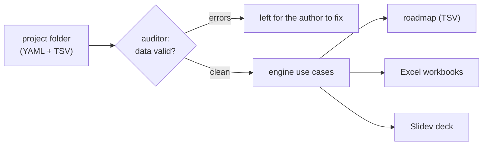

EstimateKit is a hexagonal FastAPI + CLI engine (domain / application / adapters)
with a React SPA, packaged as one container. This is the part-by-part map; what it
produces and why is in [the overview](../../).

## Parts

| Part | Lives in | Role |
|---|---|---|
| Domain | `engine/domain` | Entities and value objects (Project, ProjectSlug, AuditReport), domain services (scheduling), constants, exceptions. No outward imports. |
| Application | `engine/application` | Inbound/outbound ports and the use cases that orchestrate them: discover, scaffold a project or mint a phase in one, project lifecycle (rename, archive, unarchive, delete, summary), generate roadmap/excels/slides/all (the deck for one named phase), audit, file I/O, architecture diagrams (list, render), outputs, import/export. |
| HTTP adapter | `engine/adapters/inbound/http` | FastAPI app factory and routers (system, guide, projects, generation, files, audit, slides, architecture), DTOs and mappers, under `/api`. Serves the built SPA at `/`. |
| MCP adapter | `engine/adapters/inbound/mcp` | The same use cases as tools at `/mcp`, plus the `estimate-project` prompt; see [The MCP door](#the-mcp-door). |
| CLI adapter | `engine/adapters/inbound/cli` | An argparse command registry over the same use cases. |
| Persistence | `engine/adapters/outbound/persistence` | File-backed project and template repositories — projects live on the `/data` volume. |
| Generators | `engine/adapters/outbound/{roadmap,excel,slidev,plantuml}` | Render domain entities into a TSV roadmap, `.xlsx` workbooks (openpyxl), a Slidev deck, and the per-phase PlantUML architecture diagrams. |
| Auditor adapter | `engine/adapters/outbound/auditor` | Runs the standalone `auditor/` pytest suite over a project and collects structured results. |
| Events adapter | `engine/adapters/outbound/events` | Publishes the engine's facts to the platform event bus where the instance holds a grant; see [Events](../events/). |
| Composition root | `engine/container.py` | Wires the adapters into the use cases (the single place all layers meet). |
| Web | `web/` | React + Vite + Tailwind SPA (MVVM); served as static files by the backend in the built image. |

## How a project becomes artifacts

The auditor runs first and reports hard errors; on top of those it raises risk
*suggestions* (e.g. zero test lag, milestones bunched into one month) drawn from
delivery experience. Generation reads validated domain entities, never raw files.

## The MCP door

The MCP server mounts at `/mcp` on the same FastAPI app (streamable HTTP), one tool
per use case, so an agent runs the whole estimation loop the SPA and CLI run:

| Tool | Does |
|---|---|
| `list_projects` / `get_project_summary` | The project list, one project's headline facts. |
| `scaffold_project` | A complete example project whose sentinel-marked values the audit refuses until authored. |
| `scaffold_phase` | A new phase in an existing project: its phase-table row, its matrix column and its whole sentinel-marked file set (activities, architecture, executive summary, notes), so a minted phase audits red until authored. |
| `delete_project` / `rename_project` / `archive_project` / `unarchive_project` | The project lifecycle. |
| `list_project_files` / `read_project_file` / `write_project_file` / `delete_project_file` | The data files (YAML + TSV) an authoring agent edits. |
| `append_project_rows` / `replace_project_row` | Row-level writes to a TSV data file: append rows, or replace the one row whose ID column holds a given ID, each row checked against the header row, so a follow-on never re-sends the rows it must not touch. |
| `list_architecture_diagrams` / `render_architecture_diagram` | The per-phase PlantUML architecture diagrams. |
| `run_audit` | Audit the whole project, or a selected phase plus shared integrity; the report names its scope and carries advisory project-wide risk suggestions. |
| `generate_artifacts` / `list_output_files` | Trigger the roadmap, workbooks, and the deck for one named phase (a multi-phase project refuses slides without it); enumerate what generation produced. |
| `get_guide` | The authoring guide the estimation loop follows. |

The `estimate-project` prompt publishes the whole loop (scaffold, author from the
brief, audit until clean, generate) as a runbook the connected agent executes.
Generated artifacts stay on the instance: workbooks download over the HTTP API
(`/api/projects/<slug>/outputs/<path>`) and the deck reviews at
`/projects/<slug>/slides/`. The deck sells one phase: its executive summary,
speaker notes, architecture slide and per-phase sections are that phase's own
(`slides/P<n>-executive-summary.tsv`, `slides/P<n>-notes.tsv`,
`architecture/P<n>-components.tsv`, the guidelines whose `Phase IDs` name it),
with the cross-phase slides as context; regenerating for another phase
replaces it at the same URL.

## Access control

Deployed with the chart's OIDC gate (the default), oauth2-proxy fronts the SPA and
`/api` against the app's own Keycloak realm, and **fail-closed HTTP Basic** narrows
to the `/mcp` machine door (`ESTIMATEKIT_AUTH_SCOPE=mcp`), which cannot complete an
interactive login. Stood up without the grant, the Basic gate
(`engine/adapters/inbound/http/auth.py`, mirroring protopane) covers every route:
with no credentials configured it answers 503, never open, so a misconfigured
deploy refuses to serve rather than leak estimation data. The health endpoint at
`/api/health` stays exempt for probes. Credentials come from a Kubernetes Secret
(`k8s/values.yaml` `auth.existingSecret`); `ESTIMATEKIT_AUTH_DISABLED=true` is the
explicit local-dev opt-out. Either way the hostname is safe to publish.

## Deployment

Packaged by `devops/Dockerfile`, deployed via the `k8s/` Helm chart, exposed at
`estimatekit.<zone>` on the install that runs it, and reconciled by ArgoCD from the
app's `deploy-<install>` branch. This docs site publishes to
`docs.<zone>/apps/estimatekit` on the platform's central portal; the platform's own
docs carry the delivery model.
